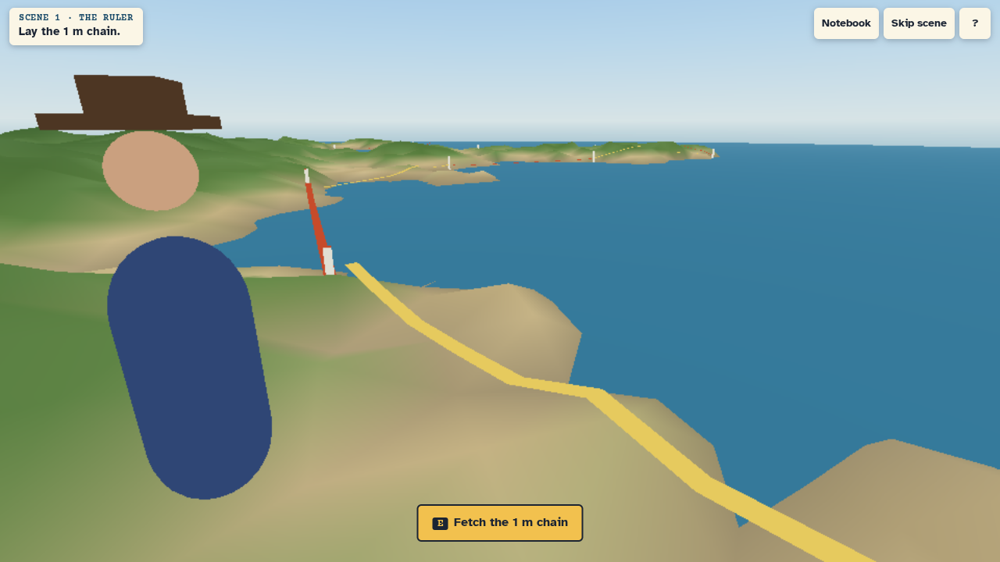

# Coastline (working title)

A walkable 3D island that teaches fractals, in the browser on Strata. You are a cartographer's apprentice, and your first job sounds easy: measure the coast. Desktop and phone both work.



This is a local first playable of scenes 1 to 3. It has no remote and isn't published anywhere.

1. **The Ruler:** lay 100 m, 10 m and 1 m chains round the coast. Guess before the last one whether the length will settle. It doesn't: the answer depends on your ruler (Richardson, and Mandelbrot's 1967 "How long is the coast of Britain?").
2. **The Snowflake:** add bumps to every edge of a triangle islet in the sand tray. Guess where the area and the coastline end up. The area stops at 8/5 of the triangle, but the coast grows 4/3 longer at every step, without end.
3. **The Net:** cast nets of shrinking mesh over the coast and count the squares it touches. Guess what halving the mesh does. Only then does the log–log diagram appear: its slope is the coast's dimension, between a line (1) and an area (2). Last, real coasts for comparison.

## Run it

```sh
cd web && python3 -m http.server 8783 --bind 127.0.0.1
```

Then open http://127.0.0.1:8783/. Add `?economy=1` for the low-detail mode.

On the Windows desktop, `play-coastline.bat` (also in `tools/`) boots Coastline as a desktop app, like the other games there. It copies this folder from WSL to `%USERPROFILE%\coastline-play`, serves it on 127.0.0.1:8784 with `py -3`, and opens it in its own window (Microsoft Edge in app mode: no tabs or address bar, its own taskbar entry and profile in `%LOCALAPPDATA%\Coastline\window`, so progress is kept between runs). Closing the window stops the server.

- `play-coastline.bat --new`: start over; the old progress is kept as the previous save (`coastline.v1.previous`).
- `play-coastline.bat --economy`: the low-detail mode.
- `play-coastline.bat --browser`: your normal browser instead of an app window.

Keyboard: W A S D or arrows walk, Shift runs, drag to look, E uses, N opens the notebook. Touch: left stick walks (push it all the way to run), drag anywhere else to look, tap the yellow button to use. The camera turns only when you turn it.

Any scene can be picked from the title screen, and **Skip scene** moves on during play.

## Playing

- **Controls:** W S or ↑ ↓ walk, A D step sideways, ← → turn, drag to look, Shift runs, E uses, N opens the notebook, M toggles sound, Esc closes a panel. On a phone: the stick walks, dragging anywhere else looks, and the yellow button uses. The camera never turns by itself.
- **Sound:** synthesised in the browser (waves and soft cues, no audio files). It starts on the first click, and the ♪ button or M mutes it; the choice is remembered. It pauses while the window is hidden.
- **Works offline:** the fonts are bundled (SIL Open Font License, licences in `web/fonts/`).
- **Phones:** portrait screens get a wider field of view, so the sand tray and the island fit. On short landscape screens panels sit on the right, keeping the goal and the stick in view.
- **Progress** is saved (`coastline.v1`). The title offers "Continue", any scene can be picked, and `--new` (or `?new`) starts over.

## What's measured

Nothing in the game is typed in by hand. Every number is computed from one coastline.

- **The island:** a radial base plus smoothstep value noise (9 octaves, gain 0.7, lacunarity 2, seed 23). The coast is the field's zero line, traced by marching squares every 0.25 m.
- **Its dimension:** box counting over the nets the game uses (16, 8, 4, 2 and 1 m) touches 47, 115, 284, 653 and 1,533 squares. That gives a dimension of **1.256** (r² 0.9997).
- **The chains:** a divider walk on that same coast gives 374.8 m with the 100 m chain, 627.3 m with 10 m and 1,130.3 m with 1 m. The slope of those three on a log–log plot gives a divider dimension of 1.24.
- **The snowflake:** perimeter and area are measured off the polygons themselves at each step. The 8/5 limit is summed from the series.
- **The box counter itself** is tested on a circle (0.999) and a Koch curve (1.260, against log 4 / log 3 = 1.262).
- **Real coasts** (approximate, from Richardson's data as read by Mandelbrot in 1967): South Africa ≈ 1.02, Australia ≈ 1.13, west coast of Britain ≈ 1.25.

## Layout

| Path | What it holds |
| --- | --- |
| `web/fractal.js` | Noise, the island, the divider, box counting, Koch. No DOM and no engine |
| `web/lessons.js` | The scenes, the guesses and their verdicts, saves |
| `web/scene.js` | The island's ground, the camp, and the chain, net and islet meshes |
| `web/main.js` | Engine boot, input, HUD, panels, figures and story |
| `web/vendor/` | The Strata kit and the arcade hall's prebuilt engine and walking code, unmodified |
| `tools/` | The Windows launcher and its small server |

## Test it

```sh
node tests/fractal.test.cjs
node tests/lessons.test.cjs
node tests/scene.test.cjs
NODE_PATH=/root/arcade-watch/node_modules node tests/play.cjs shots   # needs the server running
```

`tests/play.cjs` plays scenes 1 to 3 in Chromium with software GL on a desktop, a Pixel 7 and an iPhone 14 viewport. It takes screenshots of each scene and fails on console errors or horizontal overflow. Set `BASE` to test another address.

## Related

For self-reference and strange loops, see the GEB game (link TBD).

## Credits

- Story and code drafted by Claude on behalf of Daniel Stephenson.
- The engine is Strata with the arcade hall's walking and controls. The structure follows Second Helping, Daniel Stephenson's ranked-choice fair game.
- The ideas come from Lewis Fry Richardson's coast and border measurements, Benoit Mandelbrot, "How Long Is the Coast of Britain? Statistical Self-Similarity and Fractional Dimension", *Science* 156 (1967), and Helge von Koch's snowflake (1904).
- Fonts: Atkinson Hyperlegible, Libre Baskerville, IM Fell English and Courier Prime (SIL Open Font License 1.1), bundled from Google Fonts in `web/fonts/`.

## License

No license has been chosen for the game's own code yet. The files in `web/vendor/` keep their own licenses, listed in [web/vendor/README.md](web/vendor/README.md). The arcade hall files are under the Stephenson Software Non-Commercial License, see `web/vendor/LICENSE-arcade.md`.
